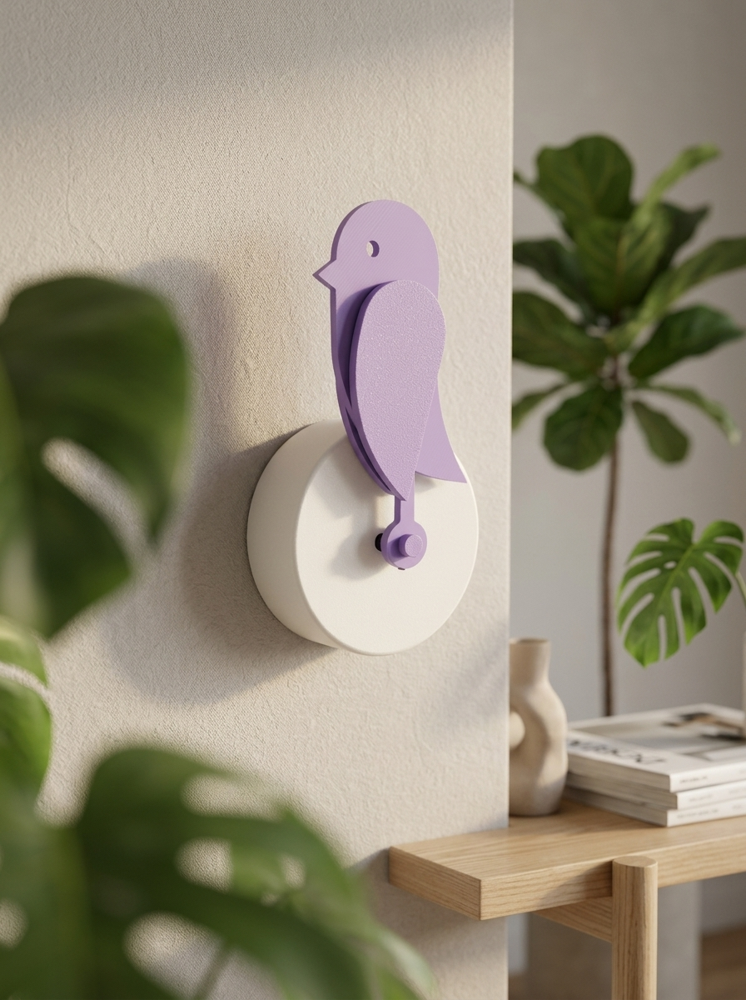
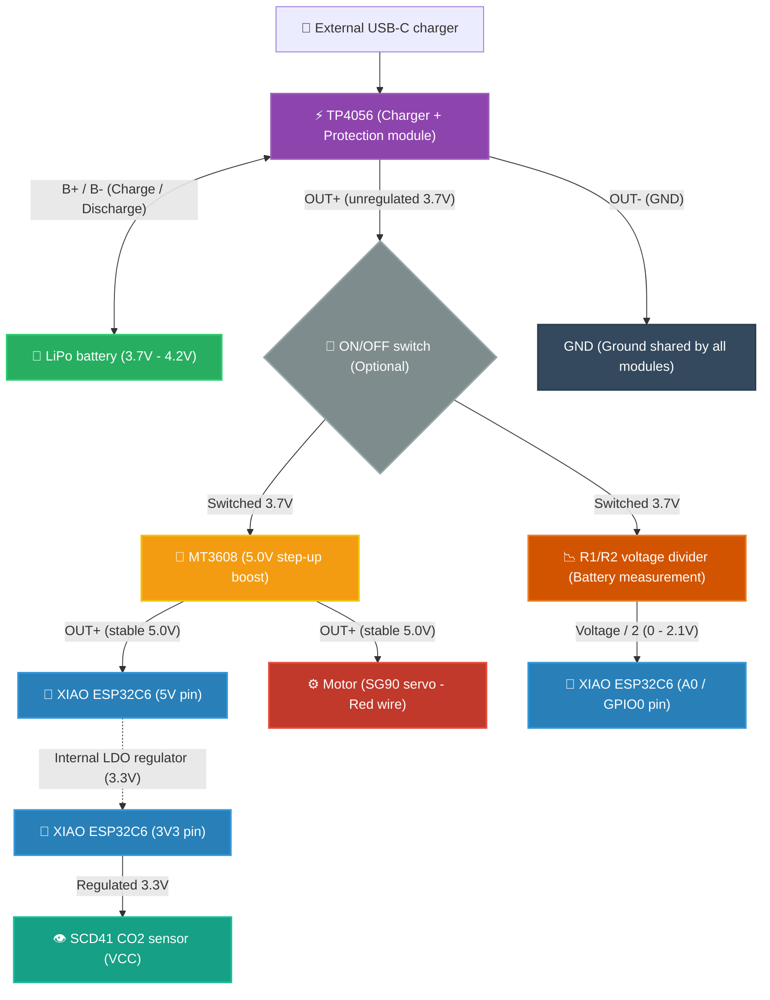
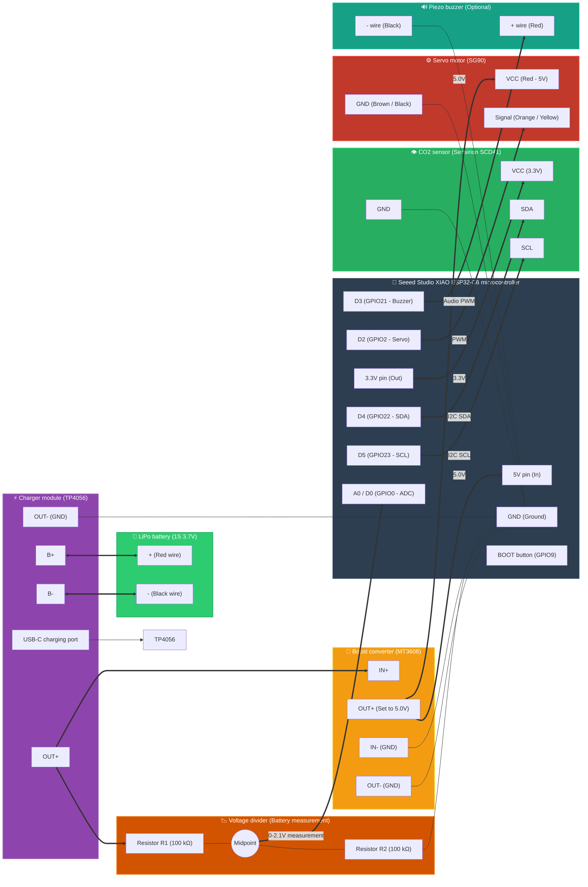
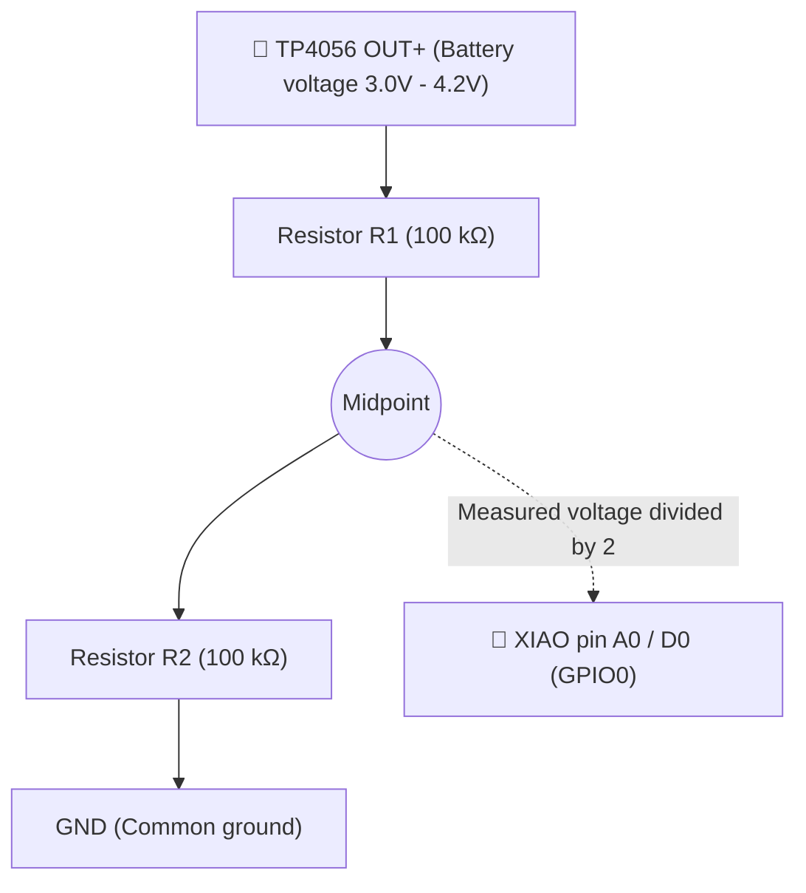
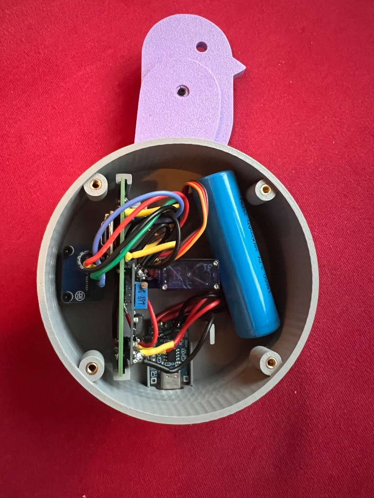
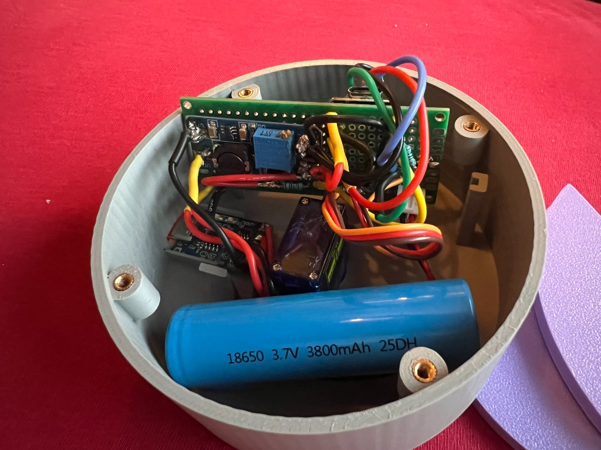

# 🐦 Birdie DIY — Open-source air quality monitor

🇫🇷 [Version française](./README.md)

<p align="center">
  
</p>

> **DIY reproduction of the [Birdie® Fresh Air Monitor™](https://birdie.design/)** — a CO2-based visual air quality indicator, inspired by the miners' canary. When the air is good, the bird stands upright. When CO2 exceeds a threshold, it drops to tell you to open the windows.


***

## 📖 About the project

[Birdie®](https://birdie.design/) is an award-winning commercial product that uses a Swiss CO2 sensor to show indoor air quality through a moving bird-shaped needle. This repository is an **open-source DIY implementation** of that concept.

The trigger logic is faithful to the original:
- The bird **drops** after **10 consecutive minutes** above **1000 ppm** (not instantly, to avoid false positives)
- The bird **rises** as soon as CO2 falls back below **950 ppm** (50 ppm of hysteresis to avoid oscillation)

***

## ✨ How it works

```
CO2 < 950 ppm   → bird up    (excellent air)
CO2 > 1000 ppm  → bird down  (open a window!)
  (after 10 consecutive minutes above the threshold)
```

Inspired by the miners' canary: miners used to take a canary down the mines to detect toxic gases. Birdie® brings this principle into the modern home.

***

## 🧰 Required hardware

### Electronic components
| Component | Part | Role |
|---|---|---|
| Microcontroller | XIAO ESP32C6 (Seeed Studio) | Brain of the project, Wi-Fi / Zigbee / Deep-Sleep |
| CO2 sensor | Sensirion SCD41 | CO2, temperature, humidity (I2C) |
| Servo | SG90 (9g) | Visual indicator (bird needle) |
| Battery charger | TP4056 with protection (DW01A) | LiPo charging via USB-C / micro-USB |
| Boost converter | MT3608 | Steps 3.7 V up to 5 V for the servo |
| Battery | 18650 Li-ion cell or 1S 3.7 V LiPo (e.g. 3800 mAh) | Long-lasting standalone power |
| Prototyping board (PCB) | Perfboard with pads (2.54 mm pitch), cut to ~30×70 mm | Central board that the components are soldered onto (XIAO, MT3608, voltage divider) and that slides into the enclosure's rails |
| R1 | 100 kΩ (1/4 W) | Battery voltage divider (upper leg) |
| R2 | 100 kΩ (1/4 W) | Battery voltage divider (lower leg) |
| Buzzer (optional) | Passive piezo buzzer (3V/5V) | Melodic chirping sound on CO2 alert |
| Switch (optional) | SPST mini slide switch | Hardware ON/OFF cutoff for the system |
| Dupont wires | 28–30 AWG prototyping wires | Internal connections |

### Hardware & screws (for the 3D-printed enclosure)
| Item | Size / Specification | Role |
|---|---|---|
| Brass threaded inserts | **M3** (4.0 mm outer diameter, 4 to 5 mm high) | Heat-set with a soldering iron into the enclosure's 4 columns |
| Machine screws | **M3** (8 mm or 10 mm long) | Close and firmly hold the front panel / lid |

***

## 🔌 Power diagram

The power chain works like this:



> ⚠️ **Adjust the MT3608 BEFORE connecting the load**:
> Before connecting the MT3608 to the XIAO or the SG90 servo, connect the battery to `IN+` / `IN-` and measure the output voltage with a multimeter. Turn the screw of the multi-turn potentiometer until you get exactly **5.0 V**.  
> 💡 *Common tip*: New MT3608 modules are often factory-set at the end of their range. You may need **15 to 20 full turns counter-clockwise** before the output voltage starts dropping toward 5 V.

### 💡 Variant: Permanent direct USB-C setup (No battery)
If you want to leave your Birdie permanently plugged into a phone charger:
* **Remove**: the TP4056, the LiPo battery, the MT3608 and the R1/R2 voltage divider.
* **Ultra-simple wiring**: Connect the SG90 servo's red wire (5V) directly to the XIAO's **`5V`** pin, the brown/black wire to **`GND`**, and simply power the XIAO through its own USB-C port.
* **Ideal firmware for this case**: [`esphome/v2.yaml`](./esphome/v2.yaml) (measures every minute with no battery-life constraint).

***

## 🔧 Complete wiring

### Pin summary table

> 📌 **Watch out for the XIAO ESP32-C6 pinout:**  
> On the board's silkscreen, pin **`D3`** is physically connected to **`GPIO21`** (not GPIO3, which is an internal GPIO dedicated to the RF antenna switch). For the buzzer, make sure you connect to physical pin **D3**!

| Signal | XIAO pin | ESP32-C6 GPIO | Connected to | Notes |
|---|---|---|---|---|
| **I2C SDA** | **D4** | GPIO22 | SCD41 SDA | I2C data communication |
| **I2C SCL** | **D5** | GPIO23 | SCD41 SCL | I2C clock |
| **Servo PWM** | **D2** | GPIO2 | SG90 orange / yellow wire | Servo control signal |
| **Buzzer (+)** | **D3** | GPIO21 | `+` wire of the passive piezo buzzer | Optional. `-` wire to common GND |
| **BOOT button** | **BOOT** | GPIO9 | Button built into the board | 5 s press = FRC calibration / Pairing |
| **Battery ADC** | **A0 / D0** | GPIO0 | Midpoint of the R1 / R2 divider | Voltage measurement (0 to 2.1 V) |
| **5V power** | **5V** | — | MT3608 `OUT+` (5.0 V) | XIAO power input |
| **3.3V sensor** | **3V3** | — | SCD41 `VCC` | Regulated 3.3 V output from the XIAO |
| **Common ground** | **GND** | — | Main ground (common GND) | Connect the GND of all modules together |

### Complete wiring diagram



> ⚠️ **Common ground (GND) is mandatory:** All points marked `GND` (TP4056 `OUT-`, MT3608 `IN-` and `OUT-`, XIAO `GND`, SG90 black wire, SCD41 `GND`, buzzer black wire, and resistor R2) must be **connected together**.
> 
> 🔋 **Wiring precautions for the TP4056 charger:**  
> - The **`B+`** and **`B-`** terminals must be connected **only to the LiPo battery wires** (Red to `B+`, Black to `B-`).
> - The **`OUT+`** and **`OUT-`** terminals power the rest of the circuit (toward the MT3608).  
> *If you mistakenly wire the circuit to `B+ / B-`, the battery will not take over when the charging cable is unplugged, and the deep-discharge protection will not work.*
> 
> 🚨 **WARNING about connecting the voltage divider (Battery measurement):**  
> - Resistor **R1 (100 kΩ)** must **always be soldered to the 3.7V battery line** (on the TP4056 `OUT+` terminal, the MT3608 `IN+` input, or directly on the LiPo's red wire).  
> - **NEVER connect R1 to the MT3608's 5V output or to the XIAO's 5V pin!** If R1 is connected to 5V, the ADC will read ~2.6 V (which corresponds to a calculated 5.2 V) and the battery will stay **stuck at 100% permanently**, never going down.

### Voltage divider details — battery measurement




| Actual battery voltage | Voltage read on A0 (GPIO0) | State of charge |
|---|---|---|
| **4.20 V** (fully charged) | ~2.10 V | 100% |
| **3.80 V** (nominal voltage) | ~1.90 V | ~60% |
| **3.40 V** (low battery threshold) | ~1.70 V | ~15% (Visual bird alert) |
| **3.25 V** (critical threshold) | ~1.62 V | ~3% (Deep-sleep cutoff) |

### ⚙️ Mechanical alignment and adjustment of the servo (SG90)

On the very first power-up (or after each upload / RESET press), the firmwares automatically run a **full test swing** in front of you:
1. **UP (180°)** position for 2 seconds.
2. Moves to the **DOWN (0°)** position for 2.5 seconds.
3. Returns to the **UP (180°)** position for 2.5 seconds.

> 💡 **How to align the bird on the shaft:**  
> - When the test ends, the motor stops exactly at the **UP position (180°)**.  
> - Press the white servo horn (or the bird's shaft) onto the splines while holding the bird **perfectly vertical**.  
> - **If the bird strains at the bottom and doesn't come back quite straight:** the assembly is off by one tooth on the shaft. Carefully unclip the horn and move it one notch upward.  
> - **If the direction is reversed (it goes down instead of up):** enable `#define SERVO_INVERT true` at the top of the firmware.

***

## ⚡ Firmware guide: Which one should you choose?

The repository offers **7 firmwares** organized into **3 distinct usage families**. Simply choose according to your needs:

```
┌────────────────────────────────────────────────────────────────────────────────────────┐
│                                WHAT IS YOUR MAIN GOAL?                                 │
├────────────────────────────────┬───────────────────────┬───────────────────────────────┤
│ 🔋 1. 100% OFFLINE (0 RF)      │ 📻 2. CONNECTED, LOW  │ 🏠 3. CONNECTED WI-FI         │
│    Bedroom, school, on the go  │    POWER (1-2 years)  │    Classic Home Assistant     │
├────────────────────────────────┼───────────────────────┼───────────────────────────────┤
│ ⭐ birdie_standalone_v2.ino     │ 📡 birdie_bthome.ino  │ ⭐ esphome/v1.yaml            │
│   (10 min in a row, battery,   │   (BLE BTHome V2,     │   (Night cycle, HA Wi-Fi,     │
│    FRC, chirping buzzer)       │    HA auto-discovery, │    3 to 4 months battery)     │
│                                │    chirping buzzer)   │                               │
│ • birdie_standalone.ino (v1)   │                       │ • esphome/v2.yaml             │
│ • esphome/standalone.yaml      │ 📻 birdie_zigbee.ino  │   (1-min readings, best on    │
│                                │   (Zigbee 3.0 ZHA/Z2M)│    permanent mains power)     │
└────────────────────────────────┴───────────────────────┴───────────────────────────────┘
```

---

### 🟢 Family 1: 100% Offline & Standalone (Zero radio emissions)

Ideal for a child's bedroom, a school, or portable use without a smartphone or router.

* **⭐ [`arduino/.../birdie_standalone_v2.ino`](./arduino/birdie_standalone_v2/birdie_standalone_v2.ino) (Recommended offline)**:
  * **10-consecutive-minutes rule** above 1,000 ppm before dropping; rises again below 950 ppm.
  * **Battery management**: monitoring on GPIO0, visual alert via the servo (< 3.40 V) and safety cutoff (< 3.25 V).
  * **Sound buzzer on D3 (GPIO21)**: gentle bird chirping when switching to alert (can be disabled via `#define ENABLE_BUZZER`).
  * **400 ppm FRC calibration**: hold the BOOT button (GPIO9) for 5 s outdoors to recalibrate the SCD41.
  * **Battery life**: **~8 to 9 months** (Strict 1 min mode) or **~16 to 18 months** (Smart Eco mode).
* **[`arduino/.../birdie_standalone.ino`](./arduino/birdie_standalone/birdie_standalone.ino)**: direct official v1 cycle (10 min healthy, 2 min alert, 2h cooldown). Battery life: **~18 to 24 months** 🏆.
* **[`esphome/standalone.yaml`](./esphome/standalone.yaml)**: v1 version compiled via ESPHome with radios disabled. Battery life: **~11 to 12 months**.

---

### 🔵 Family 2: Connected Low Power (Home Assistant — 1 to 2 years of battery life)

The perfect compromise: your data reaches Home Assistant in real time without draining the battery!

* **⭐ [`arduino/.../birdie_bthome.ino`](./arduino/birdie_bthome/birdie_bthome.ino) (New - The simplest for Home Assistant)**:
  * **BLE BTHome V2 broadcast**: sends a passive Bluetooth advertising packet in just **250 ms** on each wake-up.
  * **Native auto-discovery**: instantly recognized by Home Assistant (via native Bluetooth or an ESP32 Bluetooth Proxy) without typing a single line of code!
  * **Exposed data**: CO2 (ppm), Temperature (°C), Humidity (%), Battery (%) and Voltage (V).
  * **Buzzer chirping (D3 / GPIO21)**, visual battery alert and FRC calibration included.
  * **Record battery life**: **12 to 18 months on battery**!
* **[`arduino/.../birdie_zigbee.ino`](./arduino/birdie_zigbee/birdie_zigbee.ino) (Native Zigbee 3.0)**:
  * Joins your existing Zigbee network directly (compatible with Zigbee2MQTT and ZHA).
  * Pairing via a short press of the BOOT button (GPIO9).
  * **Record battery life**: **14 to 20 months on battery**!

---

### 🟡 Family 3: Classic Wi-Fi Connected (Home Assistant)

For those who want to use their home router's Wi-Fi without a Bluetooth Proxy antenna or a Zigbee dongle.

* **⭐ [`esphome/v1.yaml`](./esphome/v1.yaml) (Recommended on battery with Wi-Fi)**:
  * Dynamic cycle with **extended night sleep (10 pm–7 am)** until morning if the air is healthy.
  * Built-in LiPo battery monitoring and 2h cooldown. Battery life: **~3.5 to 4 months**.
* **[`esphome/v2.yaml`](./esphome/v2.yaml) (Recommended on permanent USB-C mains power)**:
  * Wakes and measures every minute with the 10-consecutive-minutes rule.
  * Ideal when continuously plugged into a USB-C charger (no battery).

---

### Comparison matrix of the 7 firmwares

| Feature | v1 (`v1.yaml`) | v2 (`v2.yaml`) | standalone (`standalone.yaml`) | Arduino v1 (`standalone.ino`) | Arduino v2 (`standalone_v2.ino`) ⭐ | BTHome (`birdie_bthome.ino`) 📡 | Zigbee (`birdie_zigbee.ino`) 📻 |
|---|---|---|---|---|---|---|---|
| **Family** | Classic Wi-Fi | Classic Wi-Fi | Offline | Offline | **Offline** | **Low Power** | **Low Power** |
| **Connectivity** | Wi-Fi + HA API | Wi-Fi + HA API | **None (0 RF)** | **None (0 RF)** | **None (0 RF)** | **Bluetooth BTHome V2** | **Zigbee 3.0 (ZHA/Z2M)** |
| **HA auto-discovery** | Yes (ESPHome) | Yes (ESPHome) | No | No | No | **Yes (native BTHome)** | **Yes (ZHA/Z2M)** |
| **Drop rule** | Direct (> 1000 ppm) | **10 consecutive min** | Direct (> 1000 ppm) | Direct (> 1000 ppm) | **10 consecutive min** | **10 consecutive min** | **10 consecutive min** |
| **Rise rule** | < 950 ppm | < 950 ppm | < 950 ppm | < 950 ppm | < 950 ppm | < 950 ppm | < 950 ppm |
| **Battery alert** | HA sensor | HA sensor | No | Servo alert | **Servo alert** | **Servo alert + Sensor** | **Zigbee cluster** |
| **FRC calibration** | No | No | No | No | **Yes (BOOT button)** | **Yes (BOOT button)** | No |
| **Chirping buzzer** | No | No | No | No | **Yes (D3 / GPIO21)** | **Yes (D3 / GPIO21)** | No |
| **Battery life (3800 mAh)**| **~3.5 to 4 months** | **~10–12 days** *(mains)* | **~11 to 12 months** | **~18 to 24 months** 🏆 | **~16 to 18 months** (Eco) | **~12 to 18 months** 🌟 | **~14 to 20 months** 🌟 |


***

## 🚀 How to flash the code to the XIAO ESP32C6

The project offers **7 firmwares** suited to your needs:
* **Connected low-power or 100% offline** (Zigbee, BLE BTHome V2, Standalone v1/v2) ➔ Flash via **VS Code (Method 1)** or **Arduino IDE (Method 2)**.
* **Wi-Fi connected** (ESPHome v1 / v2) ➔ Flash via **ESPHome Web (Method 3)** or **Home Assistant (Method 4)**.

---

### Method 1: Via VS Code & PlatformIO (Recommended, quick and simple) 💻
If you already use **Visual Studio Code**, no external compiler is required:
1. Install the **PlatformIO IDE** extension from the VS Code Extensions tab (`platformio.platformio-ide`).
2. Open the project folder in VS Code.
3. In the [`platformio.ini`](./platformio.ini) file, choose the firmware to compile by uncommenting the desired line (`arduino/birdie_zigbee` by default).
4. Connect your XIAO ESP32-C6 via USB-C.
5. Click the **`→` (PlatformIO: Upload)** arrow in the status bar at the very bottom of VS Code (or via the alien icon 👽 PlatformIO > *Project Tasks* > *Upload*).

> 💡 **Tip if your board is already asleep (Deep-Sleep) and the USB port doesn't appear:**  
> Hold down the small **B (BOOT)** button on the XIAO, briefly press the **R (RESET)** button (or plug in the USB cable), then release the **B** button. The board stays in ROM Bootloader mode: it no longer goes to sleep and its USB port stays open for flashing!

---

### Method 2: Via Arduino IDE (Classic alternative) ⚡
1. Download and install the **[Arduino IDE](https://www.arduino.cc/en/software)** (v2.x).
2. In `File > Preferences`, add the ESP32 boards manager URL:
   `https://espressif.github.io/arduino-esp32/package_esp32_index.json`
3. In `Tools > Board > Boards Manager`, install the **esp32** package by *Espressif Systems* (**v3.0.0 or later** required for the ESP32-C6 and native Zigbee).
4. Install the two required libraries via `Tools > Manage Libraries`:
   - **Sensirion I2C SCD4x** by *Sensirion*
   - **ESP32Servo** by *Kevin Harrington*
5. Open the file matching your use case:
   - `arduino/birdie_bthome/birdie_bthome.ino` *(⭐ Recommended connected BLE: HA auto-discovery)*
   - `arduino/birdie_zigbee/birdie_zigbee.ino` *(For a Zigbee 3.0 / Zigbee2MQTT / ZHA home automation network)*
   - `arduino/birdie_standalone_v2/birdie_standalone_v2.ino` *(⭐ Recommended offline: 10 min, battery alert, FRC, buzzer)*
   - `arduino/birdie_standalone/birdie_standalone.ino` *(Direct v1 logic)*
6. If you are flashing the **Zigbee** version, you must select in the `Tools` menu:
   - **Zigbee Mode**: `Zigbee ED (End Device)`
   - **Partition Scheme**: `Zigbee 4MB with spiffs`
7. Select the **Seeed Studio XIAO ESP32C6** board and the matching USB port, then click **Upload**.

---

### Method 3: Via ESPHome Web (For Wi-Fi versions, no installation) 🌐
1. Connect your XIAO ESP32C6 to your computer with a USB-C cable (that supports data).
2. Open **Google Chrome** or **Microsoft Edge** and go to [ESPHome Web](https://web.esphome.io/).
3. Click **Connect** and select your XIAO's serial port in the window that opens.
4. Click **Install**, then choose the configuration file from this repository (e.g. `esphome/v1.yaml` or `esphome/v2.yaml`).
5. Enter your Wi-Fi credentials when prompted and wait.

---

### Method 4: Via Home Assistant (ESPHome add-on) 🏠
1. Open Home Assistant and go to the **ESPHome** add-on.
2. Create a new device (**New Device** button), name it and choose **ESP32-C6**.
3. Copy the contents of `esphome/v1.yaml` (or `esphome/v2.yaml`) and paste them into the configuration editor.
4. Connect the XIAO to the machine hosting Home Assistant, or use the *Plug into this computer* method to flash through the browser.
5. Click **Install** and wait while the firmware is built.

---

### 🔗 Pairing and home automation integration

#### For the Zigbee 3.0 firmware (`birdie_zigbee.ino`):
1. In **Zigbee2MQTT** or **Home Assistant ZHA**, click **"Permit join"**.
2. On first power-up, the Birdie runs a servo travel test, then automatically searches for the network and joins it.
3. **Two power modes can be configured** at the top of the file:
   - `PERMANENT_POWERED = false` (**Battery mode**): Runs in *Smart Eco Mode* (5 min sleep in healthy air, switches to 60 s as soon as $CO_2 > 1000$ ppm to count the actual 10 min, and 2 min when the bird is down). Battery life 8-10 months.
   - `PERMANENT_POWERED = true` (**USB mains mode**): Zigbee stays connected 24/7 with no sleep, measuring and updating smoothly every 30 seconds.
4. **Factory reset / New pairing**: If you change networks or coordinators, hold the physical **BOOT (GPIO9)** button for **3 seconds**. The device erases its old Zigbee credentials and immediately starts a clean search.

#### For the Bluetooth BTHome V2 firmware (`birdie_bthome.ino`):
* **Zero configuration required**: as soon as the Birdie is on, Home Assistant (via a Bluetooth dongle or an ESP32 Bluetooth Proxy) detects it automatically with a *"New BTHome device discovered"* notification! Simply click **Configure**.


***

## 🏠 Home Assistant — Keeping the last value

When the ESP is in deep sleep (*Deep-Sleep*), native ESPHome entities switch to the `unavailable` state. To keep a continuous display and clean, gap-free graphs, use the **template sensors** provided in [`homeassistant/templates.yaml`](./homeassistant/templates.yaml).

### Integration into `configuration.yaml`

Add this line to your Home Assistant `configuration.yaml` file:

```yaml
template: !include templates.yaml
```

Or copy the following sensors directly:

> ℹ️ The sensor and entity names stay in French here and below because they match the names used by the firmware and `templates.yaml`.

```yaml
template:
  - sensor:
      - name: "CO2 Derniere Valeur"
        unique_id: co2_derniere_valeur
        unit_of_measurement: "ppm"
        device_class: carbon_dioxide
        state_class: measurement
        state: >
          {{ states('sensor.qualite_air_xiao_co2')
             if has_value('sensor.qualite_air_xiao_co2')
             else this.state }}

      - name: "Temperature Derniere Valeur"
        unique_id: temperature_derniere_valeur
        unit_of_measurement: "°C"
        device_class: temperature
        state_class: measurement
        state: >
          {{ states('sensor.qualite_air_xiao_temperature')
             if has_value('sensor.qualite_air_xiao_temperature')
             else this.state }}

      - name: "Humidite Derniere Valeur"
        unique_id: humidite_derniere_valeur
        unit_of_measurement: "%"
        device_class: humidity
        state_class: measurement
        state: >
          {{ states('sensor.qualite_air_xiao_humidite')
             if has_value('sensor.qualite_air_xiao_humidite')
             else this.state }}

      - name: "Batterie Birdie Tension"
        unique_id: birdie_batterie_tension
        unit_of_measurement: "V"
        device_class: voltage
        state_class: measurement
        state: >
          {{ states('sensor.qualite_air_xiao_batterie_tension')
             if has_value('sensor.qualite_air_xiao_batterie_tension')
             else this.state }}

      - name: "Batterie Birdie Pourcentage"
        unique_id: birdie_batterie_pourcentage
        unit_of_measurement: "%"
        device_class: battery
        state_class: measurement
        state: >
          {{ states('sensor.qualite_air_xiao_batterie_pourcentage')
             if has_value('sensor.qualite_air_xiao_batterie_pourcentage')
             else this.state }}
```


***

## 🔒 Docker deployment — ESPHome Dashboard

To host ESPHome in Docker behind a reverse proxy (Traefik, NGINX, etc.):

```yaml
services:
  esphome:
    container_name: esphome
    image: ghcr.io/esphome/esphome:latest
    environment:
      - USERNAME=admin
      - PASSWORD=motdepassefort        # ⚠️ You must change this
    volumes:
      - /opt/docker/esphome:/config
      - /etc/localtime:/etc/localtime:ro
    restart: unless-stopped
networks:
  default:
    name: proxy
    external: true
```

> ⚠️ **Security**: also remember to change the fallback AP password (`BirdieDIYFallback`) in the ESPHome YAML files before flashing. The default value `12345678` is deliberately simplistic for testing.

***

## 📊 Available Home Assistant entities

| Entity | Type | Unit |
|---|---|---|
| `sensor.qualite_air_xiao_co2` | Real-time CO2 | ppm |
| `sensor.qualite_air_xiao_temperature` | Real-time temperature | °C |
| `sensor.qualite_air_xiao_humidite` | Real-time humidity | % |
| `sensor.co2_derniere_valeur` | CO2 (last known value) | ppm |
| `sensor.temperature_derniere_valeur` | Temperature (last known value) | °C |
| `sensor.humidite_derniere_valeur` | Humidity (last known value) | % |
| `sensor.qualite_air_xiao_batterie_tension` | Battery voltage *(optional, requires R1/R2)* | V |
| `sensor.qualite_air_xiao_batterie_pourcentage` | Battery % *(optional, requires R1/R2)* | % |
| `sensor.qualite_air_xiao_etat_birdie` | Text state: "Bon - Air frais" (good, fresh air), "Mauvais - Ouvrez les fenêtres !" (bad, open the windows), "Repos / Cooldown (2h)" (rest / cooldown) | — |

***

## ⏱️ Battery life estimates for each firmware

Battery life depends directly on whether Wi-Fi is used and on the wake-up frequency. Here are detailed estimates for a **3,800 mAh 1S 3.7 V LiPo battery**:

### Battery life summary table

| Firmware | Network | Wake-up frequency | Active time | Average active current | Consumption / day | **Estimated battery life** |
|---|---|---|---|---|---|---|
| **`esphome/v2.yaml`** | Wi-Fi + HA | **Fixed 1 minute** | ~18 s | ~75 mA | ~340 mAh / day | **~10 to 12 days** *(~2–4 days without night mode)* |
| **`esphome/v1.yaml`** | Wi-Fi + HA | **10 min** *(alert 2 min, rest 2h, night 9h)* | ~15–18 s | ~70 mA | ~31 mAh / day | **~3.5 to 4 months** *(~1–2 months with frequent alerts)* |
| **`esphome/standalone.yaml`** | None (0 RF) | **10 min** *(alert 2 min, rest 2h)* | ~6–7 s | ~25 mA | ~11 mAh / day | **~11 to 12 months** |
| **`arduino/.../birdie_standalone_v2.ino` (Strict)** ⚡ | None (0 RF) | **Fixed 1 minute** | ~5.2 s | ~5 mA *(Light-Sleep)* | ~14.4 mAh / day | **~8 to 9 months** |
| **`arduino/.../birdie_standalone_v2.ino` (Smart Eco)** 🌟 | None (0 RF) | **5 min healthy air / 1 min alert** | ~5.2 s | ~5 mA *(Light-Sleep)* | ~6.7 mAh / day | **~16 to 18 months** |
| **`arduino/.../birdie_standalone.ino` (v1)** 🏆 | None (0 RF) | **10 min** *(alert 2 min, rest 2h)* | ~5.2 s | ~5 mA *(Light-Sleep)* | ~5.3 mAh / day | **~18 to 24 months** |
| **`arduino/.../birdie_bthome.ino` (BTHome V2)** 📡 | Bluetooth LE (HA) | **250 ms broadcast / 5 min** | ~5.3 s | ~6 mA *(BLE Advert)* | ~7.2 mAh / day | **~12 to 18 months** 🌟 |
| **`arduino/.../birdie_zigbee.ino` (Zigbee 3.0)** 📻 | Zigbee (ZHA/Z2M) | **Report every 5 min** | ~5.5 s | ~12 mA *(Zigbee TX)* | ~8.0 mAh / day | **~14 to 20 months** 🌟 |

---

### 🔋 Battery management and visual alerts

The voltage of the 1S LiPo cell (3.7V nominal, 4.2V max) is measured on pin **`GPIO0 (A0)`** through the voltage divider $R_1 = 100\text{ k}\Omega$ and $R_2 = 100\text{ k}\Omega$.

1. **Visual alert via the servo (< 3.40 V / ~15%)**:
   * On the Arduino versions (`birdie_standalone_v2.ino` and `birdie_standalone.ino`), if the voltage falls below **3.40 V**, the bird performs a warning animation on wake-up: it tilts to 90° and oscillates quickly (90° ↔ 45°) before returning to its normal position.
   * This gives you a visual warning that it needs recharging, with no need to open an app!
2. **Safety cutoff (< 3.25 V / ~3%)**:
   * If the battery reaches the critical threshold of 3.25 V, the bird lowers completely and the microcontroller sleeps for 1 hour without waking the SCD41, to protect the LiPo cell from deep discharge.
3. **Retained values in Home Assistant (Deep-Sleep)**:
   * Thanks to the template sensors in [`homeassistant/templates.yaml`](./homeassistant/templates.yaml), the `sensor.batterie_birdie_tension` and `sensor.batterie_birdie_pourcentage` values stay visible on your HA dashboard even while the ESP32 is asleep.

---

### 🎯 SCD41 forced calibration procedure (FRC 400 ppm)

The Sensirion SCD41 sensor can drift slightly during its first few months or after being transported. A forced calibration routine is built into `birdie_standalone_v2.ino`:

1. Place the Birdie **outdoors in fresh air** (reference concentration: ~400–420 ppm) for at least 3 to 5 minutes so the sensor stabilizes at the outdoor temperature.
2. Hold down the XIAO board's **BOOT button (GPIO9)** for **5 seconds** at power-up.
3. The firmware detects the long press and runs the Sensirion forced calibration command `scd4x.performForcedRecalibration(400)`.
4. **Visual confirmation**: the bird does a quick double up/down wing flap to confirm that the new offset has been permanently saved to the SCD41's non-volatile memory (`persistSettings()`).

---

### Detailed consumption analysis

#### 1. Why does the connected v2 (`v2.yaml`) drain so quickly?
* The ESP32 wakes up every 60 seconds. On each wake-up, it must start the Wi-Fi radio, get an IP via DHCP, sync over NTP and send its state to Home Assistant. This takes **18 seconds at ~75 mA**.
* Active duty cycle: $18 / 60 = 30\%$ of the time awake!
* Without night mode or with an average Wi-Fi signal, the battery runs out in just 2 to 4 days.

#### 2. Why does the connected v1 (`v1.yaml`) last several months?
* In healthy air, a measurement only happens every 10 minutes.
* At night (10 pm–7 am), if the air is good, the ESP stays in **continuous Deep-Sleep for 9 hours**.
* Active duty cycle: less than $2\%$ over 24 hours. Daily consumption drops to just ~31 mAh/day.

#### 3. Why do the standalone Arduino versions (`.ino`) last up to 2 years?
* **Zero radio waves (0 RF)**: the Wi-Fi and Bluetooth stage stays physically off (saves 60 mA).
* **SCD41 Single-Shot mode**: the CO2 sensor is off between measurements and only turns on for 5 seconds.
* **CPU Light-Sleep**: during the sensor's 5,000 ms measurement wait, the ESP32-C6 enters light sleep (CPU consumption reduced from 22 mA to ~1.5 mA).
* **I2C bus shutdown & PWM detach**: the servo is detached (`airServo.detach()`) and the I2C bus is released (`Wire.end()`) before entering hardware Deep-Sleep (< 10 µA).

---

### 💡 Hardware tips for record battery life

1. **Cut power to the MT3608 boost and the SG90**:
   The MT3608 boost converter draws ~0.2 to 0.5 mA at idle even when the servo isn't moving. By adding a small P-channel MOSFET (or a load switch such as the TPS22918) controlled by a XIAO GPIO pin, the servo's 5V can be fully cut during Deep-Sleep.
2. **Use a battery with a built-in PCM**:
   The DW01A low-voltage protection protects the battery from deep discharge (threshold at 2.4–3.0 V).
3. **On the connected versions**:
   The `fast_connect: true` parameter (already enabled in the YAML files) remembers the Wi-Fi channel, saving up to 3 seconds of radio scanning on each wake-up.

***

## 🖨️ 3D-printed parts

The STL and 3MF files and OpenSCAD sources are organized in the [`/parts/`](./parts/) folder:

| Folder | File | Role / Description |
|---|---|---|
| `parts/` | `birdie.3mf` | Complete multi-part 3MF project, ready to slice (Bambu Studio / OrcaSlicer) |
| `parts/bird/` | `corp.3mf` | Main body of the bird (pivoting needle) |
| `parts/bird/` | `aile1.3mf` | Front wing of the bird |
| `parts/bird/` | `aile2.3mf` | Rear wing of the bird |
| `parts/box/` | `body.stl` | Main enclosure housing the XIAO, the SCD41 and the battery |
| `parts/box/` | `case.stl` | Perforated front panel / lid |
| `parts/box/` | `axe.stl` | Mechanical drive shaft connecting the SG90 horn to the bird |
| `parts/box/` | `box-code.scad` | Parametric OpenSCAD source code for the enclosure |
| `parts/support/` | `pied.stl` | Angled stand for placing the Birdie on furniture or a desk |
| `parts/support/` | `pied-code.scad` | OpenSCAD source code for the stand |

> **Recommended print settings**: PLA or PETG, 0.20 mm layer height, 20% infill (100% infill recommended for `axe.stl`), supports recommended for the enclosure.

### 📸 A look at the real assembly and internal integration

<p align="center">
  
  &nbsp;
  
</p>

The mechanical and electronic integration takes full advantage of the cylindrical enclosure:
* **Vertical PCB board on rails**: All the main components (XIAO ESP32-C6, MT3608 boost regulator, voltage divider) are soldered onto a perfboard cut to size (~30 × 70 mm). It slides directly into the vertical rails molded into the enclosure.
* **18650 Li-ion cell**: Housed at the side for record battery life (3800 mAh).
* **USB-C charging port (TP4056)**: Positioned at the bottom of the enclosure with the USB-C socket lined up with the external cutout, for easy recharging without disassembly.
* **SCD41 sensor & SG90 servo**: Mounted in the center to line up the mechanical drive shaft with the external bird and to ensure good ambient airflow to the NDIR chamber.
* **Closure with M3 inserts**: 4 brass threaded inserts, heat-set with a soldering iron, provide clean and reversible fastening of the front panel with M3 screws.

***

## 📁 Repository structure

```
birdie-diy/
├── README.md                            ← Complete reference document (French)
├── README.en.md                         ← This document (English)
├── platformio.ini                       ← VS Code / PlatformIO build configuration
├── esphome/

│   ├── v1.yaml                          ← Official v1 firmware (Wi-Fi + Home Assistant, dynamic cycle + battery)
│   ├── v2.yaml                          ← v2 firmware (Wi-Fi + Home Assistant, 10-consecutive-minutes rule + battery)
│   └── standalone.yaml                  ← 100% offline ESPHome firmware (no Wi-Fi or BLE)
├── arduino/
│   ├── birdie_bthome/
│   │   └── birdie_bthome.ino            ← BLE BTHome V2 firmware (HA auto-discovery + buzzer, 12-18 months) 📡
│   ├── birdie_standalone_v2/
│   │   └── birdie_standalone_v2.ino     ← Standalone Arduino C++ firmware (v2 + battery alert + FRC + buzzer, 8-18 months) ⭐
│   ├── birdie_zigbee/
│   │   └── birdie_zigbee.ino            ← Native ESP32-C6 Zigbee 3.0 firmware (ZHA / Zigbee2MQTT, 14-20 months) 📻
│   └── birdie_standalone/
│       └── birdie_standalone.ino        ← Standalone Arduino C++ firmware (v1 cycle + battery monitoring, 18-24 months)
├── homeassistant/
│   └── templates.yaml                   ← HA template sensors (CO2, Temp, Humidity, Battery voltage & %)
├── docker/
│   └── docker-compose.yml               ← ESPHome Dashboard server deployment
└── parts/
    ├── birdie.3mf                       ← Complete Bambu Studio / OrcaSlicer 3MF project (multi-part plates)
    ├── bird/                            ← Individual 3MF files for the bird (body, wings)
    │   ├── corp.3mf
    │   ├── aile1.3mf
    │   └── aile2.3mf
    ├── box/                             ← Main enclosure, front panel, shaft and OpenSCAD sources
    │   ├── body.stl
    │   ├── case.stl
    │   ├── axe.stl
    │   └── box-code.scad
    └── support/                         ← Desk stand and OpenSCAD source
        ├── pied.stl
        └── pied-code.scad
```

***

## 🆚 Birdie DIY vs original Birdie®

| Aspect | Original Birdie® | Birdie DIY |
|---|---|---|
| **Price** | ~€149 | ~€15–25 (components) |
| **CO2 sensor** | Sensirion (Swiss NDIR) | Sensirion SCD41 (same Swiss manufacturer) |
| **Connectivity** | Closed proprietary Bluetooth | **Your choice of protocols**: Wi-Fi (ESPHome), open BLE (BTHome V2), Zigbee 3.0, or 100% Offline (0 RF) |
| **App** | Proprietary Birdie® app | Home Assistant (open source), Apple Home, Alexa or standalone |
| **Drop threshold** | > 1000 ppm for 10 min | Identical ✅ (`v2.yaml`, `standalone_v2.ino`, `bthome.ino`, `zigbee.ino`) |
| **Rise threshold** | < 950 ppm (hysteresis) | Identical ✅ (all versions) |
| **Bird movement** | Silent proprietary mechanism | SG90 servo (discreet, disabled after 1.5 s) |
| **Sound signal** | None | Melodic bird chirping (optional passive buzzer) 🎵 |
| **SCD41 calibration** | Automatic (ASC) only | Forced FRC calibration (400 ppm) via physical BOOT button 🎯 |
| **Power** | 3x AAA batteries or mains | USB-C rechargeable LiPo battery or permanent USB |
| **Enclosure design** | Danish recycled plastic | Printable 3D files + editable OpenSCAD + multi-plate 3MF |
| **Customization** | None | 100% open-source, modifiable firmware |
| **Battery life** | ~6 months (AAA batteries) | **Up to 18–24 months** standalone or 12–18 months on BLE/Zigbee 🏆 |

The main strength of this DIY version is its **total flexibility**: you can use it as a fully disconnected, radio-free portable device (ideal for schools or bedrooms), as an ultra-low-power beacon connected to Home Assistant over Bluetooth/Zigbee, or over classic Wi-Fi.

***

## 🔮 Possible improvements & future developments

Here are the hardware optimizations being considered for future versions of the project:

### 1. 🌙 Day/Night cycle detection without Wi-Fi (LDR photoresistor)
* **Observation**: On the offline standalone versions, the ESP32 has no NTP clock and doesn't know the actual time of night.
* **Solution**: Add a small LDR photoresistor (**GL5516** or **GL5528**, ~€0.10) with a **10 kΩ** resistor on the free analog pin `GPIO1 (A1)`.
* **Benefit**: Automatically blocks the servo's mechanical movements in the dark for total silence at night, and extends Deep-Sleep to maximize battery life.

### 2. ⚡ Complete hardware cutoff of the 5V MT3608 boost (P-channel MOSFET)
* **Observation**: The MT3608 boost converter has a constant idle leakage current of 0.2 to 0.5 mA even when the servo is still.
* **Solution**: Insert a P-channel MOSFET (e.g. **AO3401A** or **IRLML6402**) or a mini *Load Switch* module driven by a GPIO to cut the 5V outside the 2 seconds of rotation.
* **Benefit**: Standby consumption reduced to 0.0 µA on the motor line, pushing battery life to **more than 2 to 3 years**.

### 3. 🪛 Snap-fit 3D enclosure without screws
* **Observation**: Not everyone has a soldering iron to install the M3 brass threaded inserts.
* **Solution**: Offer in [`parts/box/box-code.scad`](./parts/box/box-code.scad) a front panel variant with flexible clips or a quarter-turn lock.

***

## 📝 License

This project is open source under the **MIT** license.  
It is not affiliated with Birdie® or Birdie Design ApS.  
For the original product: [birdie.design](https://birdie.design/)

***

## 🙏 Credits

- Original concept: [Birdie® Fresh Air Monitor™](https://birdie.design/) — Birdie Design ApS (Denmark)
- CO2 sensor: [Sensirion SCD41](https://sensirion.com/products/catalog/SCD41) (Switzerland)
- Firmware: [ESPHome](https://esphome.io)
- Home Assistant: [home-assistant.io](https://www.home-assistant.io)
