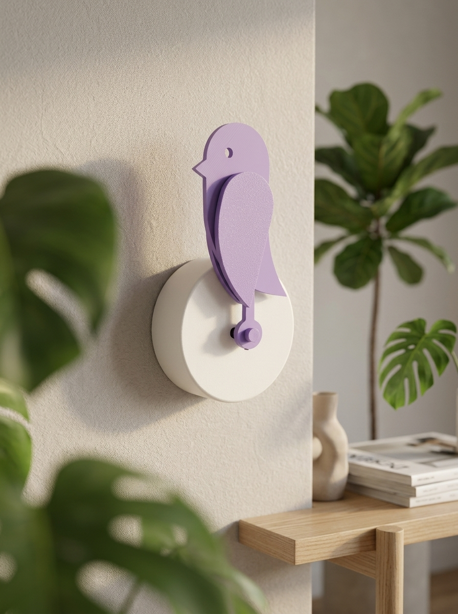
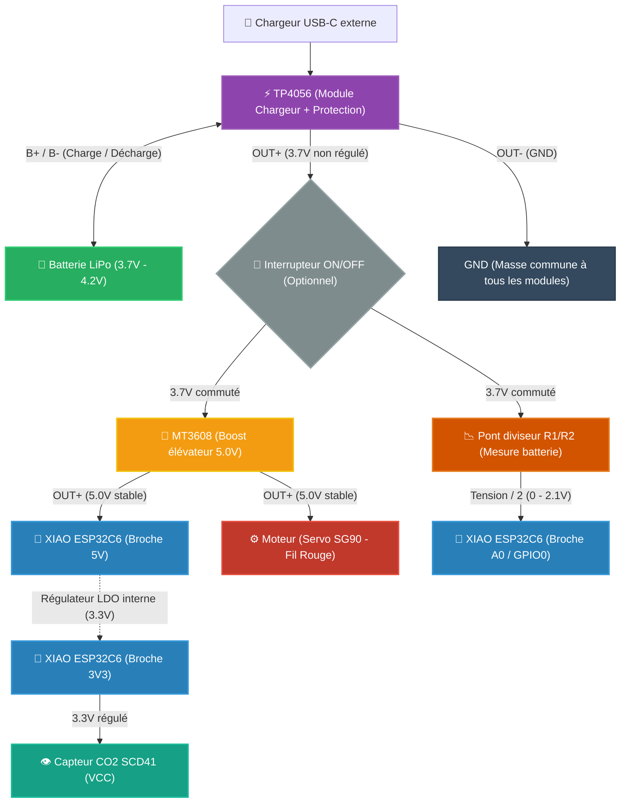
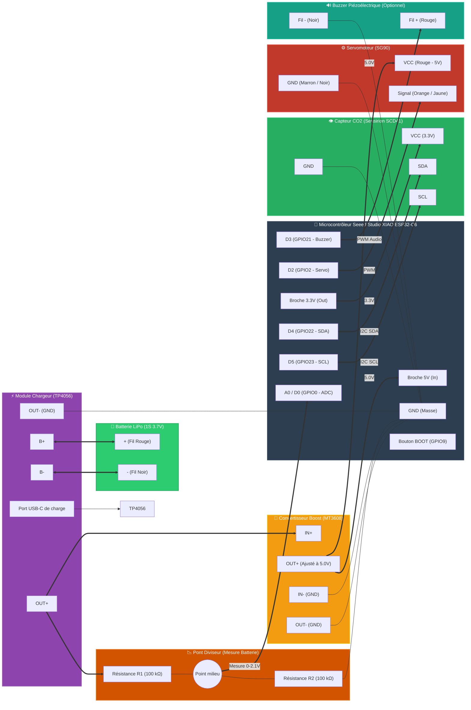
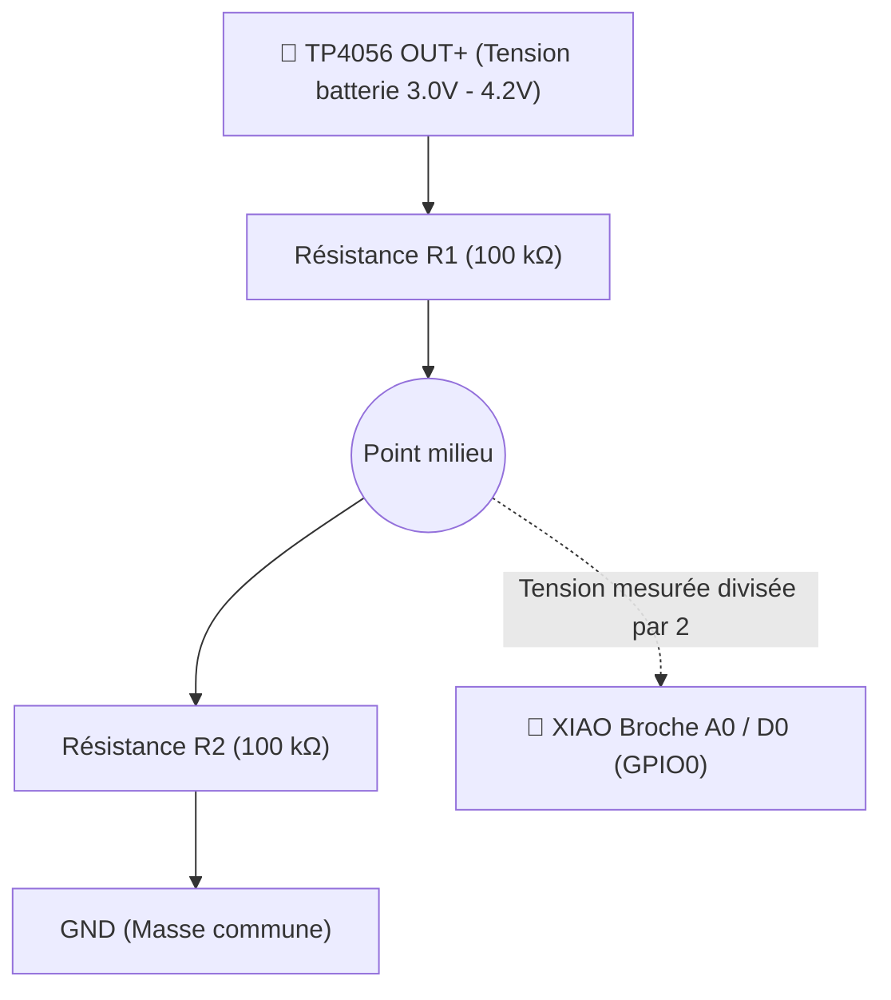
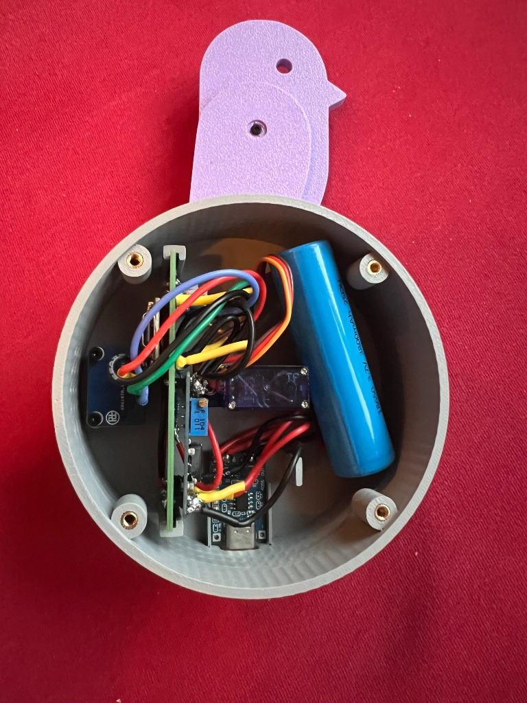
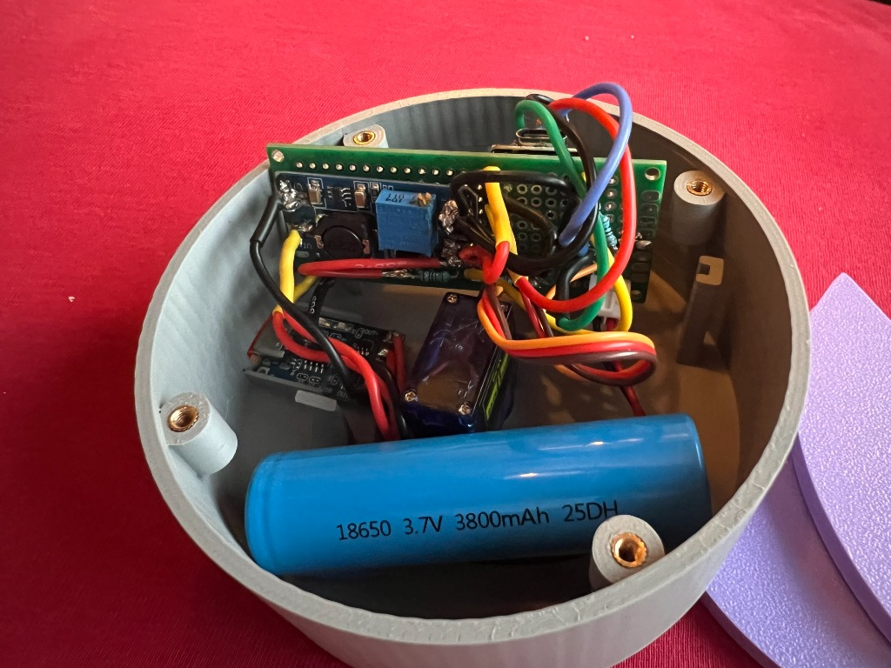

# 🐦 Birdie DIY — Moniteur de qualité d'air open source

<p align="center">
  
</p>

> **Reproduction DIY du projet [Birdie® Fresh Air Monitor™](https://birdie.design/fr)** — un indicateur visuel de qualité d'air basé sur le CO2, inspiré du canari des mineurs. Lorsque l'air est bon, l'oiseau se dresse. Lorsque le CO2 dépasse un seuil, il s'abaisse pour vous signaler d'ouvrir les fenêtres.


***

## 📖 À propos du projet

[Birdie®](https://birdie.design/fr) est un produit commercial primé qui utilise un capteur CO2 suisse pour indiquer la qualité de l'air intérieur via une aiguille mobile en forme d'oiseau. Ce dépôt est une **implémentation DIY open source** de ce concept.

La logique de déclenchement est fidèle à l'originale :
- L'oiseau **descend** après **10 minutes consécutives** au-dessus de **1000 ppm** (pas instantanément, pour éviter les faux positifs)
- L'oiseau **remonte** dès que le CO2 repasse sous **950 ppm** (hystérésis de 50 ppm pour éviter les oscillations)

***

## ✨ Fonctionnement

```
CO2 < 950 ppm   → oiseau en haut  (air excellent)
CO2 > 1000 ppm  → oiseau en bas   (aérez !)
  (après 10 min consécutives au-dessus du seuil)
```

Inspiré du canari des mineurs : autrefois, les mineurs emmenaient un canari dans les mines pour détecter les gaz toxiques. Birdie® transpose ce principe à la maison moderne.

***

## 🧰 Matériel nécessaire

### Composants électroniques
| Composant | Référence | Rôle |
|---|---|---|
| Microcontrôleur | XIAO ESP32C6 (Seeed Studio) | Cerveau du projet, Wi-Fi / Zigbee / Deep-Sleep |
| Capteur CO2 | Sensirion SCD41 | CO2, température, humidité (I2C) |
| Servo | SG90 (9g) | Indicateur visuel (aiguille oiseau) |
| Chargeur batterie | TP4056 avec protection (DW01A) | Charge LiPo via USB-C / micro-USB |
| Boost converter | MT3608 | Monte la tension 3.7 V → 5 V pour le servo |
| Batterie | Cellule Li-ion 18650 ou LiPo 1S 3.7 V (ex: 3800 mAh) | Alimentation autonome longue durée |
| Plaque de prototypage (PCB) | Plaque perforée à pastilles (Perfboard 2.54 mm) découpée ~30×70 mm | Support central sur lequel sont soudés les composants (XIAO, MT3608, pont diviseur) et qui se glisse dans les glissières du boîtier |
| R1 | 100 kΩ (1/4 W) | Pont diviseur batterie (bras haut) |
| R2 | 100 kΩ (1/4 W) | Pont diviseur batterie (bras bas) |
| Buzzer (optionnel) | Buzzer piézoélectrique passif (3V/5V) | Gazouillis sonore mélodieux lors de l'alerte CO2 |
| Interrupteur (optionnel) | Mini interrupteur à glissière SPST | Coupure matérielle ON/OFF du système |
| Câbles Dupont | Fils de prototypage 28–30 AWG | Connexions internes |

### Quincaillerie & Visserie (pour le boîtier 3D)
| Élément | Dimension / Spécification | Rôle |
|---|---|---|
| Inserts filetés en laiton | **M3** (diamètre externe 4.0 mm, hauteur 4 à 5 mm) | Insérés à chaud au fer à souder dans les 4 colonnes du boîtier |
| Vis à métaux | **M3** (longueur 8 mm ou 10 mm) | Fermeture et maintien solide de la façade / couvercle |

***

## 🔌 Schéma d'alimentation

La chaîne d'alimentation fonctionne ainsi :



> ⚠️ **Régler le MT3608 AVANT de brancher la charge** :
> Avant de relier le MT3608 au XIAO ou au servo SG90, branchez la batterie sur `IN+` / `IN-` et mesurez la tension en sortie avec un multimètre. Tournez la vis du potentiomètre multitour pour obtenir exactement **5.0 V**.  
> 💡 *Astuce fréquente* : Les modules MT3608 neufs sont souvent réglés en butée d'usine. Il faut parfois faire **15 à 20 tours complets dans le sens inverse des aiguilles d'une montre (sens anti-horaire)** avant que la tension de sortie ne commence à descendre vers 5 V.

### 💡 Variante : Montage direct USB-C permanent (Sans batterie)
Si vous souhaitez laisser votre Birdie branché en permanence sur un chargeur de téléphone :
* **Supprimez** : le TP4056, la batterie LiPo, le MT3608 et le pont diviseur R1/R2.
* **Câblage ultra-simple** : Branchez directement le fil rouge (5V) du servo SG90 sur la broche **`5V`** du XIAO, le fil marron/noir sur **`GND`**, et alimentez simplement le XIAO via son propre port USB-C.
* **Firmware idéal dans ce cas** : [`esphome/v2.yaml`](./esphome/v2.yaml) (mesure chaque minute sans contrainte d'autonomie).

***

## 🔧 Câblage complet

### Tableau récapitulatif des broches

> 📌 **Attention au pinout du XIAO ESP32-C6 :**  
> Sur la sérigraphie de la carte, la broche **`D3`** est reliée physiquement au **`GPIO21`** (et non à GPIO3, qui est un GPIO interne dédié au switch d'antenne RF). Pour le buzzer, branchez bien sur la broche physique **D3** !

| Signal | Broche XIAO | GPIO ESP32-C6 | Connecté à | Notes |
|---|---|---|---|---|
| **I2C SDA** | **D4** | GPIO22 | SCD41 SDA | Communication données I2C |
| **I2C SCL** | **D5** | GPIO23 | SCD41 SCL | Horloge I2C |
| **Servo PWM** | **D2** | GPIO2 | SG90 fil orange / jaune | Signal de commande du servomoteur |
| **Buzzer (+)** | **D3** | GPIO21 | Fil `+` du buzzer piézoélectrique passif | Optionnel. Fil `-` au GND commun |
| **Bouton BOOT** | **BOOT** | GPIO9 | Bouton intégré sur la carte | Appui 5s = Calibration FRC / Appairage |
| **ADC Batterie** | **A0 / D0** | GPIO0 | Point milieu du pont R1 / R2 | Mesure de tension (0 à 2.1 V) |
| **Alimentation 5V** | **5V** | — | MT3608 `OUT+` (5.0 V) | Entrée d'alimentation du XIAO |
| **Capteur 3.3V** | **3V3** | — | SCD41 `VCC` | Sortie 3.3 V régulée fournie par le XIAO |
| **Masse commune** | **GND** | — | Masse générale (GND commun) | Relier les GND de tous les modules |

### Schéma de câblage complet



> ⚠️ **Masse commune (GND) obligatoire :** Tous les points marqués `GND` (TP4056 `OUT-`, MT3608 `IN-` et `OUT-`, XIAO `GND`, SG90 fil noir, SCD41 `GND`, Buzzer fil noir, et résistance R2) doivent être **reliés ensemble**.
> 
> 🔋 **Précautions de câblage sur le chargeur TP4056 :**  
> - Les bornes **`B+`** et **`B-`** doivent être reliées **uniquement aux fils de la batterie LiPo** (Rouge sur `B+`, Noir sur `B-`).
> - Les bornes **`OUT+`** et **`OUT-`** alimentent le reste du circuit (vers le MT3608).  
> *Si vous câblez par erreur le circuit sur `B+ / B-`, la batterie ne prendra pas le relais lorsque le câble de charge est débranché et les sécurités anti-décharge profonde seront inopérantes.*

### Détail du pont diviseur — mesure de la batterie




| Tension réelle de la batterie | Tension lue sur A0 (GPIO0) | État de charge |
|---|---|---|
| **4.20 V** (pleine charge) | ~2.10 V | 100% |
| **3.80 V** (tension nominale) | ~1.90 V | ~60% |
| **3.40 V** (seuil batterie faible) | ~1.70 V | ~15% (Alerte visuelle oiseau) |
| **3.25 V** (seuil critique) | ~1.62 V | ~3% (Coupure veille profonde) |

***

## ⚡ Guide des firmwares : Lequel choisir selon vos besoins ?

Le dépôt propose **7 firmwares** organisés en **3 familles d'usage distinctes**. Choisissez simplement selon votre besoin :

```
┌────────────────────────────────────────────────────────────────────────────────────────┐
│                        QUEL EST VOTRE OBJECTIF PRINCIPAL ?                             │
├────────────────────────────────┬───────────────────────┬───────────────────────────────┤
│ 🔋 1. 100% HORS-LIGNE (0 ONDE) │ 📻 2. CONNECTÉ BASSE  │ 🏠 3. CONNECTÉ WI-FI          │
│    Chambre, école, nomade      │    CONSO (1 à 2 ans)  │    Home Assistant classique   │
├────────────────────────────────┼───────────────────────┼───────────────────────────────┤
│ ⭐ birdie_standalone_v2.ino     │ 📡 birdie_bthome.ino  │ ⭐ esphome/v1.yaml            │
│   (10 min conséc., batterie,   │   (BLE BTHome V2,     │   (Cycle nuit, HA Wi-Fi,      │
│    FRC, buzzer gazouillis)     │    Auto-discovery HA, │    autonomie 3 à 4 mois)      │
│                                │    buzzer gazouillis) │                               │
│ • birdie_standalone.ino (v1)   │                       │ • esphome/v2.yaml             │
│ • esphome/standalone.yaml      │ 📻 birdie_zigbee.ino  │   (Mesure 1 min, conseillé    │
│                                │   (Zigbee 3.0 ZHA/Z2M)│    sur secteur permanent)     │
└────────────────────────────────┴───────────────────────┴───────────────────────────────┘
```

---

### 🟢 Famille 1 : 100% Hors-Ligne & Autonome (Zéro émission radio)

Idéal pour une chambre d'enfant, une école ou une utilisation nomade sans smartphone ni routeur.

* **⭐ [`arduino/.../birdie_standalone_v2.ino`](./arduino/birdie_standalone_v2/birdie_standalone_v2.ino) (Recommandé hors-ligne)** :
  * **Règle des 10 minutes consécutives** au-dessus de 1 000 ppm avant descente ; remontée sous 950 ppm.
  * **Gestion de batterie** : surveillance sur GPIO0, alerte visuelle par le servomoteur (< 3.40 V) et coupure de sécurité (< 3.25 V).
  * **Buzzer sonore sur D3 (GPIO21)** : gazouillis d'oiseau doux lors de la bascule en alerte (désactivable via `#define ENABLE_BUZZER`).
  * **Calibration FRC 400 ppm** : maintien 5s du bouton BOOT (GPIO9) à l'extérieur pour recalibrer le SCD41.
  * **Autonomie** : **~8 à 9 mois** (Mode Strict 1 min) ou **~16 à 18 mois** (Mode Smart Éco).
* **[`arduino/.../birdie_standalone.ino`](./arduino/birdie_standalone/birdie_standalone.ino)** : cycle officiel v1 direct (10 min sain, 2 min alerte, 2h cooldown). Autonomie : **~18 à 24 mois** 🏆.
* **[`esphome/standalone.yaml`](./esphome/standalone.yaml)** : version v1 compilable via ESPHome avec radios neutralisées. Autonomie : **~11 à 12 mois**.

---

### 🔵 Famille 2 : Connecté Basse Consommation (Home Assistant — Autonomie 1 à 2 ans)

Le compromis parfait : vos données remontent en temps réel dans Home Assistant sans vider la batterie !

* **⭐ [`arduino/.../birdie_bthome.ino`](./arduino/birdie_bthome/birdie_bthome.ino) (Nouveau - Le plus simple pour Home Assistant)** :
  * **Diffusion BLE BTHome V2** : émet un paquet publicitaire Bluetooth passif en seulement **250 ms** à chaque réveil.
  * **Auto-Discovery native** : reconnu instantanément par Home Assistant (via Bluetooth natif ou ESP32 Bluetooth Proxy) sans taper une seule ligne de code !
  * **Données exposées** : CO2 (ppm), Température (°C), Humidité (%), Batterie (%) et Tension (V).
  * **Gazouillis buzzer (D3 / GPIO21)**, alerte visuelle batterie et calibration FRC inclus.
  * **Autonomie record** : **12 à 18 mois sur batterie** !
* **[`arduino/.../birdie_zigbee.ino`](./arduino/birdie_zigbee/birdie_zigbee.ino) (Zigbee 3.0 Natif)** :
  * Rejoint directement votre réseau Zigbee existant (compatible Zigbee2MQTT et ZHA).
  * Appairage via appui court sur le bouton BOOT (GPIO9).
  * **Autonomie record** : **14 à 20 mois sur batterie** !

---

### 🟡 Famille 3 : Connecté Wi-Fi classique (Home Assistant)

Pour ceux qui veulent utiliser le Wi-Fi de leur box sans antenne Bluetooth Proxy ni clé Zigbee.

* **⭐ [`esphome/v1.yaml`](./esphome/v1.yaml) (Recommandé sur batterie avec Wi-Fi)** :
  * Cycle dynamique avec **sommeil nocturne prolongé (22h–7h)** jusqu'au matin si l'air est sain.
  * Surveillance batterie LiPo intégrée et Cooldown 2h. Autonomie : **~3.5 à 4 mois**.
* **[`esphome/v2.yaml`](./esphome/v2.yaml) (Recommandé sur secteur permanent USB-C)** :
  * Réveil et mesure chaque minute avec règle des 10 minutes consécutives.
  * Idéal branché en continu sur un chargeur USB-C (sans batterie).

---

### Matrice comparative des 7 firmwares

| Caractéristique | v1 (`v1.yaml`) | v2 (`v2.yaml`) | standalone (`standalone.yaml`) | Arduino v1 (`standalone.ino`) | Arduino v2 (`standalone_v2.ino`) ⭐ | BTHome (`birdie_bthome.ino`) 📡 | Zigbee (`birdie_zigbee.ino`) 📻 |
|---|---|---|---|---|---|---|---|
| **Famille** | Wi-Fi classique | Wi-Fi classique | Hors-ligne | Hors-ligne | **Hors-ligne** | **Basse Conso** | **Basse Conso** |
| **Connectivité** | Wi-Fi + HA API | Wi-Fi + HA API | **Aucune (0 RF)** | **Aucune (0 RF)** | **Aucune (0 RF)** | **Bluetooth BTHome V2** | **Zigbee 3.0 (ZHA/Z2M)** |
| **Auto-Discovery HA** | Oui (ESPHome) | Oui (ESPHome) | Non | Non | Non | **Oui (BTHome natif)** | **Oui (ZHA/Z2M)** |
| **Règle descente** | Direct (> 1000 ppm) | **10 min conséc.** | Direct (> 1000 ppm) | Direct (> 1000 ppm) | **10 min conséc.** | **10 min conséc.** | **10 min conséc.** |
| **Règle remontée** | < 950 ppm | < 950 ppm | < 950 ppm | < 950 ppm | < 950 ppm | < 950 ppm | < 950 ppm |
| **Alerte batterie** | Sensor HA | Sensor HA | Non | Alerte servo | **Alerte servo** | **Alerte servo + Sensor** | **Cluster Zigbee** |
| **Calibration FRC** | Non | Non | Non | Non | **Oui (Bouton BOOT)** | **Oui (Bouton BOOT)** | Non |
| **Buzzer gazouillis** | Non | Non | Non | Non | **Oui (D3 / GPIO21)** | **Oui (D3 / GPIO21)** | Non |
| **Autonomie (3800 mAh)**| **~3.5 à 4 mois** | **~10–12 j** *(secteur)* | **~11 à 12 mois** | **~18 à 24 mois** 🏆 | **~16 à 18 mois** (Éco) | **~12 à 18 mois** 🌟 | **~14 à 20 mois** 🌟 |


***

## 🚀 Comment flasher le code sur le XIAO ESP32C6

Le projet propose **7 firmwares** adaptés à vos besoins :
* **Connectés basse consommation ou 100% hors-ligne** (Zigbee, BLE BTHome V2, Standalone v1/v2) ➔ Flasher via **VS Code (Méthode 1)** ou **Arduino IDE (Méthode 2)**.
* **Connectés Wi-Fi** (ESPHome v1 / v2) ➔ Flasher via **ESPHome Web (Méthode 3)** ou **Home Assistant (Méthode 4)**.

---

### Méthode 1 : Via VS Code & PlatformIO (Recommandé, simple et rapide) 💻
Si vous utilisez déjà **Visual Studio Code**, aucun compilateur externe n'est requis :
1. Installez l'extension **PlatformIO IDE** depuis l'onglet Extensions de VS Code (`platformio.platformio-ide`).
2. Ouvrez le dossier du projet dans VS Code.
3. Dans le fichier [`platformio.ini`](./platformio.ini), choisissez le firmware à compiler en décommentant la ligne souhaitée (par défaut `arduino/birdie_zigbee`).
4. Branchez votre XIAO ESP32-C6 en USB-C.
5. Cliquez sur la flèche **`→` (PlatformIO: Upload)** dans la barre d'état tout en bas de VS Code (ou via l'icône alien 👽 PlatformIO > *Project Tasks* > *Upload*).

> 💡 **Astuce si votre carte dort déjà (Deep-Sleep) et que le port USB n'apparaît pas :**  
> Maintenez enfoncé le petit bouton **B (BOOT)** sur le XIAO, appuyez brièvement sur le bouton **R (RESET)** (ou branchez le câble USB), puis relâchez le bouton **B**. La carte se fige en mode Bootloader ROM : elle ne s'endort plus et son port USB reste ouvert en permanence pour le flash !

---

### Méthode 2 : Via Arduino IDE (Alternative classique) ⚡
1. Téléchargez et installez l'**[Arduino IDE](https://www.arduino.cc/en/software)** (v2.x).
2. Dans `Fichier > Préférences`, ajoutez l'URL du gestionnaire de cartes ESP32 :
   `https://espressif.github.io/arduino-esp32/package_esp32_index.json`
3. Dans `Outils > Type de carte > Gestionnaire de cartes`, installez le package **esp32** par *Espressif Systems* (**v3.0.0 ou ultérieure** obligatoire pour l'ESP32-C6 et le Zigbee natif).
4. Installez les deux bibliothèques requises via `Outils > Gérer les bibliothèques` :
   - **Sensirion I2C SCD4x** par *Sensirion*
   - **ESP32Servo** par *Kevin Harrington*
5. Ouvrez le fichier correspondant à votre usage :
   - `arduino/birdie_bthome/birdie_bthome.ino` *(⭐ Recommandé connecté BLE : Auto-découverte HA)*
   - `arduino/birdie_zigbee/birdie_zigbee.ino` *(Pour réseau domotique Zigbee 3.0 / Zigbee2MQTT / ZHA)*
   - `arduino/birdie_standalone_v2/birdie_standalone_v2.ino` *(⭐ Recommandé hors-ligne : 10 min, alerte batterie, FRC, buzzer)*
   - `arduino/birdie_standalone/birdie_standalone.ino` *(Logique v1 directe)*
6. Si vous flashez la version **Zigbee**, sélectionnez impérativement dans le menu `Outils` :
   - **Zigbee Mode** : `Zigbee ED (End Device)`
   - **Partition Scheme** : `Zigbee 4MB with spiffs`
7. Sélectionnez la carte **Seeed Studio XIAO ESP32C6** et le port USB correspondant, puis cliquez sur **Téléverser**.

---

### Méthode 3 : Via ESPHome Web (Pour les versions Wi-Fi, sans installation) 🌐
1. Branchez votre XIAO ESP32C6 à votre ordinateur via un câble USB-C (supportant les données).
2. Ouvrez le navigateur **Google Chrome** ou **Microsoft Edge** et allez sur [ESPHome Web](https://web.esphome.io/).
3. Cliquez sur **Connect** et sélectionnez le port série de votre XIAO dans la fenêtre qui s'ouvre.
4. Cliquez sur **Install** puis choisissez le fichier de configuration de ce dépôt (ex: `esphome/v1.yaml` ou `esphome/v2.yaml`).
5. Renseignez vos identifiants Wi-Fi lorsque cela vous est demandé et patientez.

---

### Méthode 4 : Via Home Assistant (Module ESPHome) 🏠
1. Ouvrez Home Assistant et allez dans le module complémentaire **ESPHome**.
2. Créez un nouvel appareil (bouton **New Device**), nommez-le et choisissez **ESP32-C6**.
3. Copiez le contenu de `esphome/v1.yaml` (ou `esphome/v2.yaml`) et collez-le dans l'éditeur de configuration.
4. Branchez le XIAO à la machine hébergeant Home Assistant, ou utilisez la méthode *Plug into this computer* pour flasher via le navigateur.
5. Cliquez sur **Install** et patientez pendant la création du firmware.

---

### 🔗 Appairage et intégration domotique

#### Pour le firmware Zigbee 3.0 (`birdie_zigbee.ino`) :
1. Dans **Zigbee2MQTT** ou **Home Assistant ZHA**, cliquez sur **"Autoriser l'appairage"** (*Permit join*).
2. Au premier allumage, le Birdie cherche automatiquement le réseau pendant 90 secondes et s'associe.
3. **Réinitialisation usine / Nouvel appairage** : En cas de changement de réseau ou de coordinateur, maintenez le bouton physique **BOOT (GPIO9)** enfoncé pendant **3 secondes**. L'appareil efface ses anciens identifiants Zigbee et relance immédiatement une recherche propre.

#### Pour le firmware Bluetooth BTHome V2 (`birdie_bthome.ino`) :
* **Zéro configuration requise** : dès que le Birdie est allumé, Home Assistant (via une clé Bluetooth ou un ESP32 Bluetooth Proxy) le détecte automatiquement avec une notification *"Nouvel appareil BTHome découvert"* ! Cliquez simplement sur **Configurer**.


***

## 🏠 Home Assistant — Conserver la dernière valeur

Quand l'ESP est en sommeil profond (*Deep-Sleep*), les entités natives d'ESPHome passent à l'état `unavailable`. Pour conserver un affichage continu et de beaux graphiques sans coupures, utilisez les **template sensors** fournis dans [`homeassistant/templates.yaml`](./homeassistant/templates.yaml).

### Intégration dans `configuration.yaml`

Ajoutez cette ligne dans votre fichier `configuration.yaml` de Home Assistant :

```yaml
template: !include templates.yaml
```

Ou copiez directement les capteurs suivants :

```yaml
template:
  - sensor:
      - name: "CO2 Derniere Valeur"
        unique_id: co2_derniere_valeur
        unit_of_measurement: "ppm"
        device_class: carbon_dioxide
        state_class: measurement
        state: >
          {{ states('sensor.qualite_air_xiao_co2')
             if has_value('sensor.qualite_air_xiao_co2')
             else this.state }}

      - name: "Temperature Derniere Valeur"
        unique_id: temperature_derniere_valeur
        unit_of_measurement: "°C"
        device_class: temperature
        state_class: measurement
        state: >
          {{ states('sensor.qualite_air_xiao_temperature')
             if has_value('sensor.qualite_air_xiao_temperature')
             else this.state }}

      - name: "Humidite Derniere Valeur"
        unique_id: humidite_derniere_valeur
        unit_of_measurement: "%"
        device_class: humidity
        state_class: measurement
        state: >
          {{ states('sensor.qualite_air_xiao_humidite')
             if has_value('sensor.qualite_air_xiao_humidite')
             else this.state }}

      - name: "Batterie Birdie Tension"
        unique_id: birdie_batterie_tension
        unit_of_measurement: "V"
        device_class: voltage
        state_class: measurement
        state: >
          {{ states('sensor.qualite_air_xiao_batterie_tension')
             if has_value('sensor.qualite_air_xiao_batterie_tension')
             else this.state }}

      - name: "Batterie Birdie Pourcentage"
        unique_id: birdie_batterie_pourcentage
        unit_of_measurement: "%"
        device_class: battery
        state_class: measurement
        state: >
          {{ states('sensor.qualite_air_xiao_batterie_pourcentage')
             if has_value('sensor.qualite_air_xiao_batterie_pourcentage')
             else this.state }}
```


***

## 🔒 Déploiement Docker — ESPHome Dashboard

Pour héberger ESPHome dans Docker derrière un reverse proxy (Traefik, NGINX, etc.) :

```yaml
services:
  esphome:
    container_name: esphome
    image: ghcr.io/esphome/esphome:latest
    environment:
      - USERNAME=admin
      - PASSWORD=motdepassefort        # ⚠️ À changer absolument
    volumes:
      - /opt/docker/esphome:/config
      - /etc/localtime:/etc/localtime:ro
    restart: unless-stopped
networks:
  default:
    name: proxy
    external: true
```

> ⚠️ **Sécurité** : penser aussi à changer le mot de passe du fallback AP (`BirdieDIYFallback`) dans les fichiers YAML ESPHome avant de flasher. La valeur par défaut `12345678` est volontairement simpliste pour les tests.

***

## 📊 Entités Home Assistant disponibles

| Entité | Type | Unité |
|---|---|---|
| `sensor.qualite_air_xiao_co2` | CO2 temps réel | ppm |
| `sensor.qualite_air_xiao_temperature` | Température temps réel | °C |
| `sensor.qualite_air_xiao_humidite` | Humidité temps réel | % |
| `sensor.co2_derniere_valeur` | CO2 (dernière valeur connue) | ppm |
| `sensor.temperature_derniere_valeur` | Température (dernière valeur connue) | °C |
| `sensor.humidite_derniere_valeur` | Humidité (dernière valeur connue) | % |
| `sensor.qualite_air_xiao_batterie_tension` | Tension batterie *(optionnel, nécessite R1/R2)* | V |
| `sensor.qualite_air_xiao_batterie_pourcentage` | % batterie *(optionnel, nécessite R1/R2)* | % |
| `sensor.qualite_air_xiao_etat_birdie` | État textuel ("Bon - Air frais", "Mauvais - Ouvrez les fenêtres !", "Repos / Cooldown (2h)") | — |

***

## ⏱️ Estimations d'autonomie pour chaque firmware

L'autonomie dépend directement de la présence du Wi-Fi et de la fréquence de réveil. Voici les estimations détaillées pour une **batterie LiPo 1S 3.7 V de 3 800 mAh** :

### Tableau récapitulatif des autonomies

| Firmware | Réseau | Fréquence de réveil | Durée active | Courant moyen actif | Consommation / jour | **Autonomie estimée** |
|---|---|---|---|---|---|---|
| **`esphome/v2.yaml`** | Wi-Fi + HA | **1 minute fixe** | ~18 s | ~75 mA | ~340 mAh / jour | **~10 à 12 jours** *(~2–4 j sans mode nuit)* |
| **`esphome/v1.yaml`** | Wi-Fi + HA | **10 min** *(alerte 2 min, repos 2h, nuit 9h)* | ~15–18 s | ~70 mA | ~31 mAh / jour | **~3.5 à 4 mois** *(~1–2 mois si alertes fréquentes)* |
| **`esphome/standalone.yaml`** | Aucun (0 RF) | **10 min** *(alerte 2 min, repos 2h)* | ~6–7 s | ~25 mA | ~11 mAh / jour | **~11 à 12 mois** |
| **`arduino/.../birdie_standalone_v2.ino` (Strict)** ⚡ | Aucun (0 RF) | **1 minute fixe** | ~5.2 s | ~5 mA *(Light-Sleep)* | ~14.4 mAh / jour | **~8 à 9 mois** |
| **`arduino/.../birdie_standalone_v2.ino` (Smart Éco)** 🌟 | Aucun (0 RF) | **5 min air sain / 1 min alerte** | ~5.2 s | ~5 mA *(Light-Sleep)* | ~6.7 mAh / jour | **~16 à 18 mois** |
| **`arduino/.../birdie_standalone.ino` (v1)** 🏆 | Aucun (0 RF) | **10 min** *(alerte 2 min, repos 2h)* | ~5.2 s | ~5 mA *(Light-Sleep)* | ~5.3 mAh / jour | **~18 à 24 mois** |
| **`arduino/.../birdie_bthome.ino` (BTHome V2)** 📡 | Bluetooth LE (HA) | **Diffusion 250 ms / 5 min** | ~5.3 s | ~6 mA *(BLE Advert)* | ~7.2 mAh / jour | **~12 à 18 mois** 🌟 |
| **`arduino/.../birdie_zigbee.ino` (Zigbee 3.0)** 📻 | Zigbee (ZHA/Z2M) | **Rapport toutes les 5 min** | ~5.5 s | ~12 mA *(Zigbee TX)* | ~8.0 mAh / jour | **~14 à 20 mois** 🌟 |

---

### 🔋 Gestion de la batterie et alertes visuelles

La tension de la cellule LiPo 1S (3.7V nominal, 4.2V max) est mesurée sur la broche **`GPIO0 (A0)`** via le pont diviseur $R_1 = 100\text{ k}\Omega$ et $R_2 = 100\text{ k}\Omega$.

1. **Alerte visuelle par le servomoteur (< 3.40 V / ~15%)** :
   * Sur les versions Arduino (`birdie_standalone_v2.ino` et `birdie_standalone.ino`), si la tension descend sous **3.40 V**, l'oiseau effectue une animation d'avertissement au réveil : il s'incline à 90° et oscille rapidement (90° ↔ 45°) avant de reprendre sa position normale.
   * Vous êtes ainsi averti visuellement qu'il faut recharger l'objet sans avoir besoin d'ouvrir une application !
2. **Coupure de sécurité (< 3.25 V / ~3%)** :
   * Si la batterie atteint le seuil critique de 3.25 V, l'oiseau s'abaisse complètement et le microcontrôleur s'endort pour 1 heure sans réveiller le SCD41 afin de protéger l'accu LiPo contre la décharge profonde.
3. **Mémorisation dans Home Assistant (Deep-Sleep)** :
   * Grâce aux sensors templates dans [`homeassistant/templates.yaml`](./homeassistant/templates.yaml), les valeurs `sensor.batterie_birdie_tension` et `sensor.batterie_birdie_pourcentage` restent affichées en continu sur votre tableau de bord HA même lorsque l'ESP32 est endormi.

---

### 🎯 Procédure de calibration forcée du SCD41 (FRC 400 ppm)

Le capteur Sensirion SCD41 peut dériver légèrement au cours des premiers mois ou après un transport. Une routine d'étalonnage forcé est intégrée dans `birdie_standalone_v2.ino` :

1. Placez le Birdie à **l'extérieur dans de l'air frais** (concentration de référence : ~400–420 ppm) pendant au moins 3 à 5 minutes pour stabiliser le capteur à la température extérieure.
2. Maintenez enfoncé le **bouton BOOT (GPIO9)** de la carte XIAO pendant **5 secondes** à l'allumage.
3. Le firmware détecte l'appui long et lance la commande de calibration forcée Sensirion `scd4x.performForcedRecalibration(400)`.
4. **Confirmation visuelle** : l'oiseau effectue un double battement d'ailes rapide haut/bas pour confirmer que le nouvel offset est sauvegardé de manière permanente dans la mémoire non-volatile du SCD41 (`persistSettings()`).

---

### Analyse détaillée des consommations

#### 1. Pourquoi la v2 connectée (`v2.yaml`) se vide-t-elle si vite ?
* L'ESP32 se réveille toutes les 60 secondes. À chaque réveil, il doit démarrer l'émetteur radio Wi-Fi, obtenir une IP en DHCP, se synchroniser en NTP et envoyer son état à Home Assistant. Cela prend **18 secondes à ~75 mA**.
* Rapport cyclique actif : $18 / 60 = 30\%$ du temps éveillé !
* En l'absence de mode nuit ou avec un signal Wi-Fi moyen, la batterie s'épuise en seulement 2 à 4 jours.

#### 2. Pourquoi la v1 connectée (`v1.yaml`) tient-elle plusieurs mois ?
* En air sain, la mesure n'a lieu que toutes les 10 minutes.
* La nuit (22h–7h), si l'air est bon, l'ESP dort en **Deep-Sleep continu pendant 9 heures**.
* Rapport cyclique actif : moins de $2\%$ sur 24 heures. La consommation journalière tombe à seulement ~31 mAh/jour.

#### 3. Pourquoi les versions Arduino autonomes (`.ino`) tiennent-elles jusqu'à 2 ans ?
* **Zéro onde radio (0 RF)** : l'étage Wi-Fi et Bluetooth reste physiquement éteint (économie de 60 mA).
* **Mode Single-Shot SCD41** : le capteur CO2 est éteint entre chaque mesure et ne s'allume que pendant 5 secondes.
* **Light-Sleep du CPU** : pendant les 5 000 ms d'attente de mesure du capteur, l'ESP32-C6 passe en sommeil léger (consommation CPU réduite de 22 mA à ~1.5 mA).
* **Coupe du bus I2C & détachement PWM** : le servo est détaché (`airServo.detach()`) et le bus I2C est libéré (`Wire.end()`) avant d'entrer en Deep-Sleep matériel (< 10 µA).

---

### 💡 Astuces matérielles pour battre des records d'autonomie

1. **Couper l'alimentation du Boost MT3608 et du SG90** :
   Le convertisseur boost MT3608 consomme ~0.2 à 0.5 mA à vide même quand le servo ne bouge pas. En ajoutant un petit transistor MOSFET canal P (ou un commutateur de charge type TPS22918) commandé par une broche GPIO du XIAO, le 5V du servo peut être totalement coupé pendant le Deep-Sleep.
2. **Utiliser une batterie avec PCM intégré** :
   La protection basse tension DW01A protège la batterie contre la décharge profonde (seuil à 2.4–3.0 V).
3. **Sur les versions connectées** :
   Le paramètre `fast_connect: true` (déjà activé dans les YAML) permet de mémoriser le canal Wi-Fi pour économiser jusqu'à 3 secondes de scan radio à chaque réveil.

***

## 🖨️ Pièces imprimées en 3D

Les fichiers STL, 3MF et sources OpenSCAD sont organisés dans le dossier [`/parts/`](./parts/) :

| Dossier | Fichier | Rôle / Description |
|---|---|---|
| `parts/` | `birdie.3mf` | Projet 3MF complet multi-pièces prêt à trancher (Bambu Studio / OrcaSlicer) |
| `parts/bird/` | `corp.3mf` | Corps principal de l'oiseau (aiguille pivotante) |
| `parts/bird/` | `aile1.3mf` | Aile avant de l'oiseau |
| `parts/bird/` | `aile2.3mf` | Aile arrière de l'oiseau |
| `parts/box/` | `body.stl` | Boîtier principal accueillant le XIAO, le SCD41 et la batterie |
| `parts/box/` | `case.stl` | Façade / couvercle avant ajouré |
| `parts/box/` | `axe.stl` | Axe d'entraînement mécanique reliant le palonnier SG90 à l'oiseau |
| `parts/box/` | `box-code.scad` | Code source OpenSCAD paramétrique du boîtier |
| `parts/support/` | `pied.stl` | Support incliné pour poser le Birdie sur un meuble ou un bureau |
| `parts/support/` | `pied-code.scad` | Code source OpenSCAD du pied de support |

> **Paramètres d'impression conseillés** : PLA ou PETG, hauteur de couche 0.20 mm, remplissage 20% (remplissage 100% conseillé pour `axe.stl`), supports recommandés pour le boîtier.

### 📸 Aperçu du montage réel et intégration interne

<p align="center">
  
  &nbsp;
  
</p>

L'intégration mécanique et électronique tire pleinement parti du boîtier cylindrique :
* **Plaque PCB verticale sur glissières** : Tous les composants principaux (XIAO ESP32-C6, régulateur élévateur MT3608, pont diviseur de tension) sont soudés sur une plaque de prototypage perforée découpée aux dimensions (~30 × 70 mm). Elle s'insère directement dans les glissières verticales moulées dans le boîtier.
* **Cellule Li-ion 18650** : Logée sur le côté pour offrir une autonomie record (3800 mAh).
* **Port de recharge USB-C (TP4056)** : Positionné au fond du boîtier avec la prise USB-C alignée avec la découpe extérieure pour recharger facilement sans démontage.
* **Capteur SCD41 & Servomoteur SG90** : Fixés au centre pour aligner l'axe mécanique d'entraînement avec l'oiseau extérieur et assurer une bonne circulation de l'air ambiant vers la chambre NDIR.
* **Fermeture par inserts M3** : 4 inserts filetés en laiton insérés à chaud au fer à souder garantissent un vissage propre et réversible de la façade avec des vis M3.

***

## 📁 Structure du dépôt

```
birdie-diy/
├── README.md                            ← Ce document récapitulatif complet
├── platformio.ini                       ← Configuration de compilation VS Code / PlatformIO
├── esphome/

│   ├── v1.yaml                          ← Firmware v1 officiel (Wi-Fi + Home Assistant, cycle dynamique + batterie)
│   ├── v2.yaml                          ← Firmware v2 (Wi-Fi + Home Assistant, règle 10 min consécutives + batterie)
│   └── standalone.yaml                  ← Firmware ESPHome 100% hors-ligne (sans Wi-Fi ni BLE)
├── arduino/
│   ├── birdie_bthome/
│   │   └── birdie_bthome.ino            ← Firmware BLE BTHome V2 (Auto-découverte HA + buzzer, 12-18 mois) 📡
│   ├── birdie_standalone_v2/
│   │   └── birdie_standalone_v2.ino     ← Firmware Arduino C++ autonome (v2 + alerte batterie + FRC + buzzer, 8-18 mois) ⭐
│   ├── birdie_zigbee/
│   │   └── birdie_zigbee.ino            ← Firmware Zigbee 3.0 Natif ESP32-C6 (ZHA / Zigbee2MQTT, 14-20 mois) 📻
│   └── birdie_standalone/
│       └── birdie_standalone.ino        ← Firmware Arduino C++ autonome (cycle v1 + monitoring batterie, 18-24 mois)
├── homeassistant/
│   └── templates.yaml                   ← Template sensors HA (CO2, Temp, Humidité, Tension & % Batterie)
├── docker/
│   └── docker-compose.yml               ← Déploiement du serveur ESPHome Dashboard
└── parts/
    ├── birdie.3mf                       ← Projet 3MF complet Bambu Studio / OrcaSlicer (plateaux multi-pièces)
    ├── bird/                            ← Fichiers 3MF individuels de l'oiseau (corps, ailes)
    │   ├── corp.3mf
    │   ├── aile1.3mf
    │   └── aile2.3mf
    ├── box/                             ← Boîtier principal, façade, axe et sources OpenSCAD
    │   ├── body.stl
    │   ├── case.stl
    │   ├── axe.stl
    │   └── box-code.scad
    └── support/                         ← Support de table et source OpenSCAD
        ├── pied.stl
        └── pied-code.scad
```

***

## 🆚 Birdie DIY vs Birdie® original

| Aspect | Birdie® original | Birdie DIY |
|---|---|---|
| **Prix** | ~149 € | ~15–25 € (composants) |
| **Capteur CO2** | Sensirion (NDIR suisse) | Sensirion SCD41 (même fabricant suisse) |
| **Connectivité** | Bluetooth propriétaire fermé | **Multi-protocoles au choix** : Wi-Fi (ESPHome), BLE ouvert (BTHome V2), Zigbee 3.0, ou 100% Hors-Ligne (0 RF) |
| **Application** | App Birdie® propriétaire | Home Assistant (open source), Apple Home, Alexa ou autonome |
| **Seuil descente** | > 1000 ppm pendant 10 min | Identique ✅ (`v2.yaml`, `standalone_v2.ino`, `bthome.ino`, `zigbee.ino`) |
| **Seuil remontée** | < 950 ppm (hystérésis) | Identique ✅ (toutes versions) |
| **Mouvement oiseau** | Mécanisme propriétaire silencieux | Servomoteur SG90 (discret, désactivé après 1.5s) |
| **Signal sonore** | Aucun | Gazouillis d'oiseau mélodieux (Buzzer passif optionnel) 🎵 |
| **Étalonnage SCD41** | Automatique (ASC) uniquement | Calibration forcée FRC (400 ppm) via bouton physique BOOT 🎯 |
| **Alimentation** | 3x piles AAA ou secteur | Batterie LiPo rechargeable USB-C ou USB permanent |
| **Design boîtier** | Plastique recyclé danois | Fichiers 3D imprimables + OpenSCAD modifiable + 3MF multi-plateaux |
| **Personnalisation** | Aucune | Firmware 100% open source et modifiable |
| **Autonomie sur batterie** | ~6 mois (piles AAA) | **Jusqu'à 18–24 mois** en autonome ou 12–18 mois en BLE/Zigbee 🏆 |

La principale force de cette version DIY réside dans sa **flexibilité totale** : vous pouvez l'utiliser aussi bien en objet nomade totalement déconnecté sans onde (idéal pour les écoles ou chambres), qu'en balise ultra-basse consommation connectée à Home Assistant en Bluetooth/Zigbee, ou encore en Wi-Fi classique.

***

## 🔮 Axes d'amélioration & Évolutions futures

Voici les pistes d'optimisation matérielle envisagées pour les prochaines évolutions du projet :

### 1. 🌙 Détection du cycle Jour/Nuit sans Wi-Fi (Photorésistance LDR)
* **Constat** : Sur les versions autonomes hors-ligne, l'ESP32 ne dispose pas d'horloge NTP et ignore l'heure réelle de la nuit.
* **Solution** : Ajouter une petite photorésistance LDR (référence **GL5516** ou **GL5528**, ~0.10 €) associée à une résistance de **10 kΩ** sur la broche analogique libre `GPIO1 (A1)`.
* **Bénéfice** : Bloque automatiquement les mouvements mécaniques du servo dans l'obscurité pour un silence total la nuit et allonge le Deep-Sleep pour maximiser l'autonomie.

### 2. ⚡ Coupure matérielle complète du Boost 5V MT3608 (MOSFET Canal P)
* **Constat** : Le convertisseur élévateur MT3608 présente un courant de fuite à vide de 0.2 à 0.5 mA permanent même quand le servo est immobile.
* **Solution** : Intercaler un transistor MOSFET canal P (ex: **AO3401A** ou **IRLML6402**) ou un mini module *Load Switch* piloté par un GPIO pour couper le 5V en dehors des 2 secondes de rotation.
* **Bénéfice** : Consommation en veille réduite à 0.0 µA sur la ligne moteur, repoussant l'autonomie à **plus de 2 à 3 ans** sur batterie.

### 3. 🪛 Boîtier 3D clipsable sans visserie (Fermeture Snap-fit)
* **Constat** : Tout le monde ne dispose pas d'un fer à souder pour insérer les inserts filetés en laiton M3.
* **Solution** : Proposer dans [`parts/box/box-code.scad`](./parts/box/box-code.scad) une variante de façade avec des ergots flexibles (clips) ou un verrouillage quart-de-tour.

***

## 📝 Licence

Ce projet est open source sous licence **MIT**.  
Il n'est pas affilié à Birdie® ou Birdie Design ApS.  
Pour le produit original : [birdie.design](https://birdie.design/fr)

***

## 🙏 Crédits

- Concept original : [Birdie® Fresh Air Monitor™](https://birdie.design/fr) — Birdie Design ApS (Danemark)
- Capteur CO2 : [Sensirion SCD41](https://sensirion.com/products/catalog/SCD41) (Suisse)
- Firmware : [ESPHome](https://esphome.io)
- Home Assistant : [home-assistant.io](https://www.home-assistant.io)